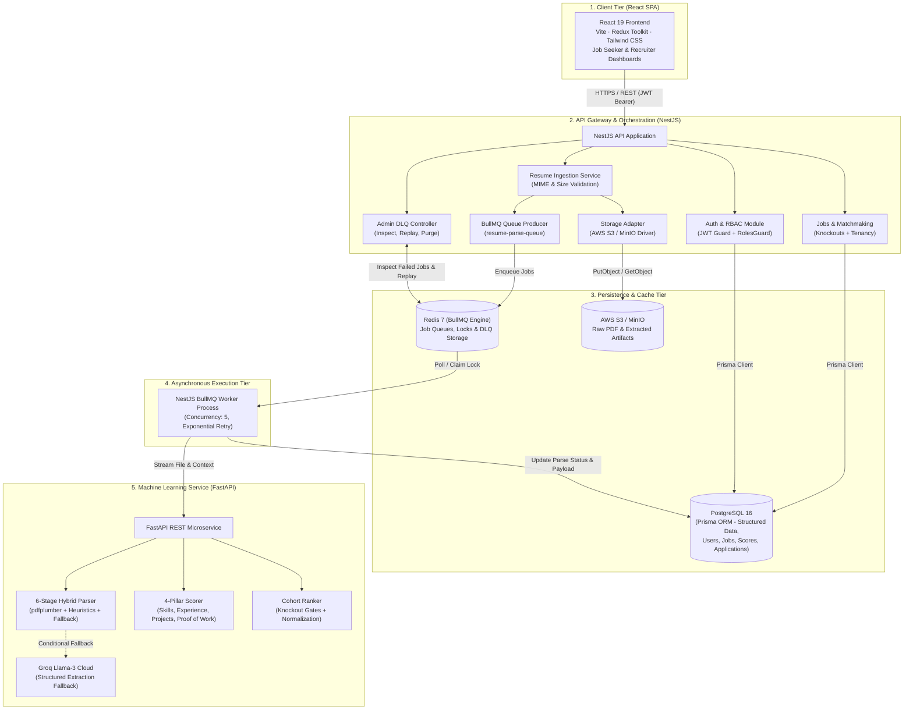
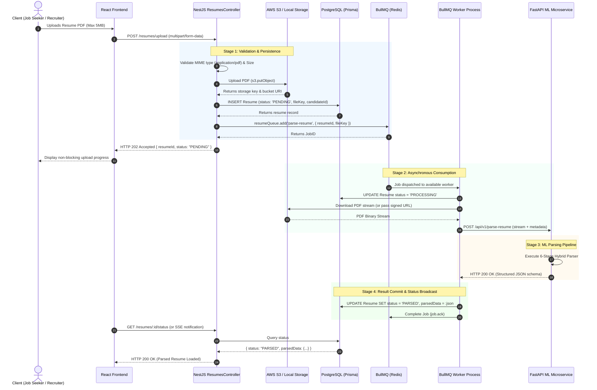
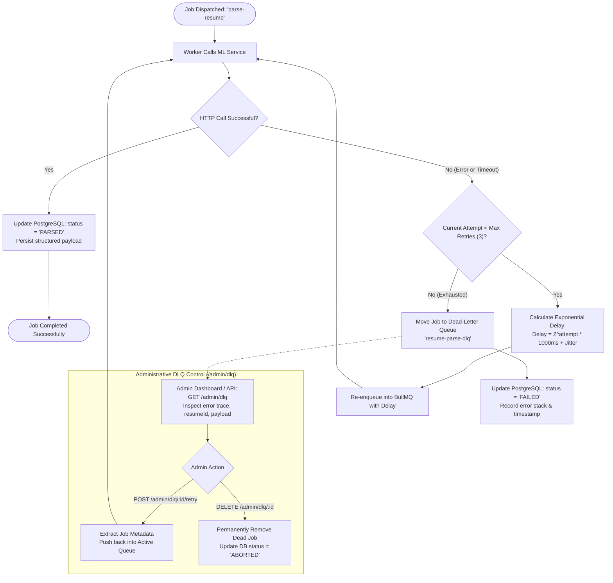
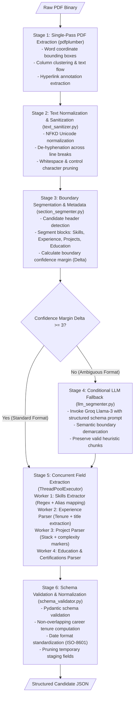
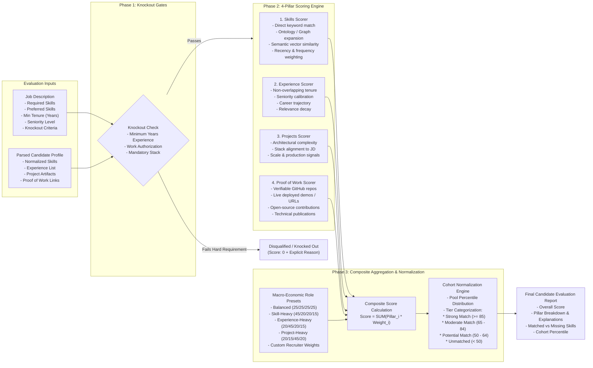
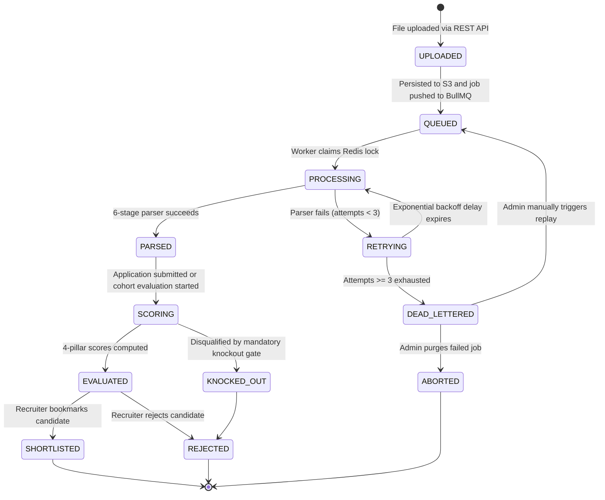
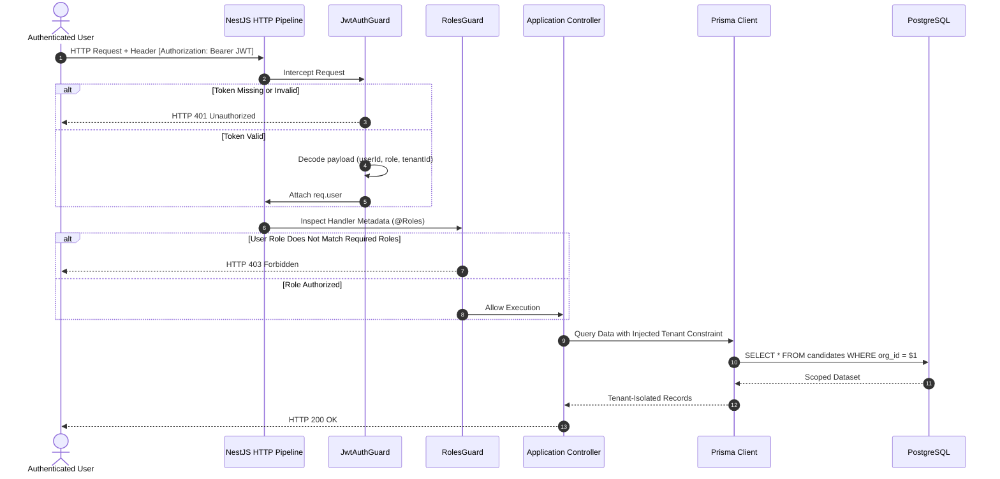
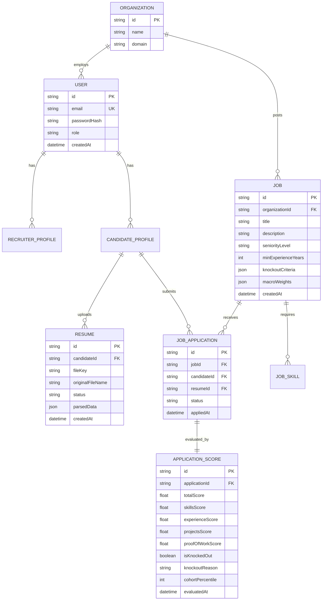

# HireLens — System Architecture & Technical Specifications

> **System Overview**: HireLens is an enterprise-grade, distributed technical hiring and candidate evaluation platform. It replaces superficial keyword matching with a multi-dimensional, deterministic evaluation engine backed by asynchronous queue workers, a 6-stage hybrid resume parsing pipeline, and a resilient distributed architecture.

---

## Table of Contents
1. [High-Level System Topology](#1-high-level-system-topology)
2. [Asynchronous Ingestion & Distributed Job Processing](#2-asynchronous-ingestion--distributed-job-processing)
3. [Fault Tolerance, Exponential Backoff & DLQ Lifecycle](#3-fault-tolerance-exponential-backoff--dlq-lifecycle)
4. [6-Stage Hybrid Resume Parsing Pipeline](#4-6-stage-hybrid-resume-parsing-pipeline)
5. [4-Pillar Deterministic Scoring Engine & Cohort Ranking](#5-4-pillar-deterministic-scoring-engine--cohort-ranking)
6. [Resume & Application State Machine](#6-resume--application-state-machine)
7. [Authentication, RBAC & Multi-Tenant Security](#7-authentication-rbac--multi-tenant-security)
8. [Data Persistence & Entity Relational Schema](#8-data-persistence--entity-relational-schema)
9. [Operational Considerations & Latency Budgets](#9-operational-considerations--latency-budgets)
10. [Technology Stack Summary](#10-technology-stack-summary)

---

## 1. High-Level System Topology

HireLens is architected as a **decoupled 3-tier distributed system** designed for horizontal scalability, fault isolation, and independent deployment cycles.

---

## 2. Asynchronous Ingestion & Distributed Job Processing

Resume parsing and multi-candidate scoring are compute-heavy operations (PDF geometric analysis, OCR, LLM inference). To preserve a sub-100ms API response time, document ingestion is completely decoupled from parsing execution via an asynchronous message queue.

---

## 3. Fault Tolerance, Exponential Backoff & DLQ Lifecycle

Transient failures (network partitions, downstream ML timeouts, rate limits) must not result in data loss. HireLens implements a robust Dead-Letter Queue (DLQ) pattern with exponential backoff and administrative controls.

---

## 4. 6-Stage Hybrid Resume Parsing Pipeline

The ML parsing engine combines deterministic layout heuristics with conditional LLM fallback to maximize accuracy while minimizing API costs and execution latency.

---

## 5. 4-Pillar Deterministic Scoring Engine & Cohort Ranking

Rather than relying on opaque similarity embeddings alone, HireLens uses a **deterministic 4-pillar scoring architecture** anchored in explicit engineering competencies.

---

## 6. Resume & Application State Machine

The candidate evaluation and resume processing lifecycle follows a formal finite state machine (FSM), ensuring database consistency across all concurrent mutations.

---

## 7. Authentication, RBAC & Multi-Tenant Security

HireLens enforces strict role-based access control (RBAC) and organizational tenant isolation at both the HTTP gateway and the database access layer.

---

## 8. Data Persistence & Entity Relational Schema

The relational schema is maintained via Prisma ORM on PostgreSQL, enforcing cascading integrity, multi-column indexes, and normalized scoring records.

---

## 9. Operational Considerations & Latency Budgets

| Operation | Target P50 | Target P95 | Fallback / Mitigation Strategy |
|---|---|---|---|
| **Resume Upload & Enqueue** | < 80ms | < 200ms | Direct streaming to S3; instantaneous Redis job enqueue |
| **Heuristic Parsing (Stages 1-3, 5-6)** | 1.2s | 2.5s | Single-pass disk I/O; concurrent thread pool for field extraction |
| **LLM-Fallback Parsing (Stage 4)** | 2.8s | 4.5s | Invoked only when boundary confidence $\Delta < 3$; Groq Llama-3 high-throughput tokens |
| **4-Pillar Single Candidate Scoring** | 150ms | 350ms | Pre-compiled skill graphs, cached vector embeddings, in-memory tenure math |
| **Cohort Ranking (100 candidates)** | 600ms | 1.4s | Vectorized NumPy operations, matrix dot-products, parallel pillar aggregation |
| **Dead-Letter Recovery** | < 50ms | < 120ms | Atomic Redis state mutations with transactional BullMQ job repointing |

---

## 10. Technology Stack Summary

* **Frontend**: React 19, Vite, Tailwind CSS, Redux Toolkit, React Router 7.
* **Backend Gateway**: NestJS 10, TypeScript, Prisma ORM, BullMQ, Passport JWT.
* **Data Stores**: PostgreSQL 16 (Primary ACID), Redis 7 (Queues & Distributed Locks), AWS S3 (Blobs).
* **ML Microservice**: Python 3.11, FastAPI, Pydantic v2, pdfplumber, spaCy, Groq SDK (Llama-3).
* **Testing & Quality**: Jest (NestJS unit & integration), Pytest (ML scoring engine & parser suites), Multi-tenant isolation specs.
